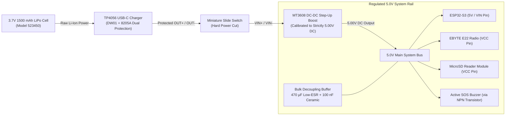
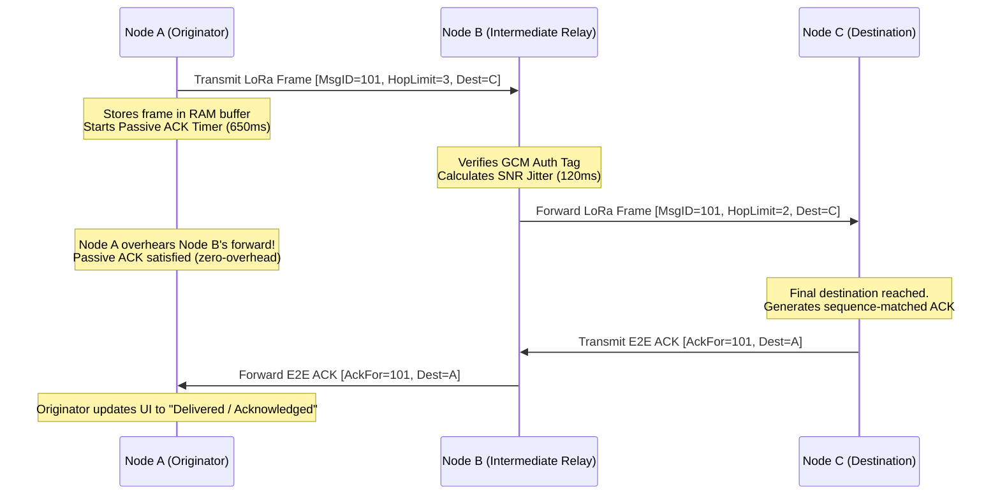
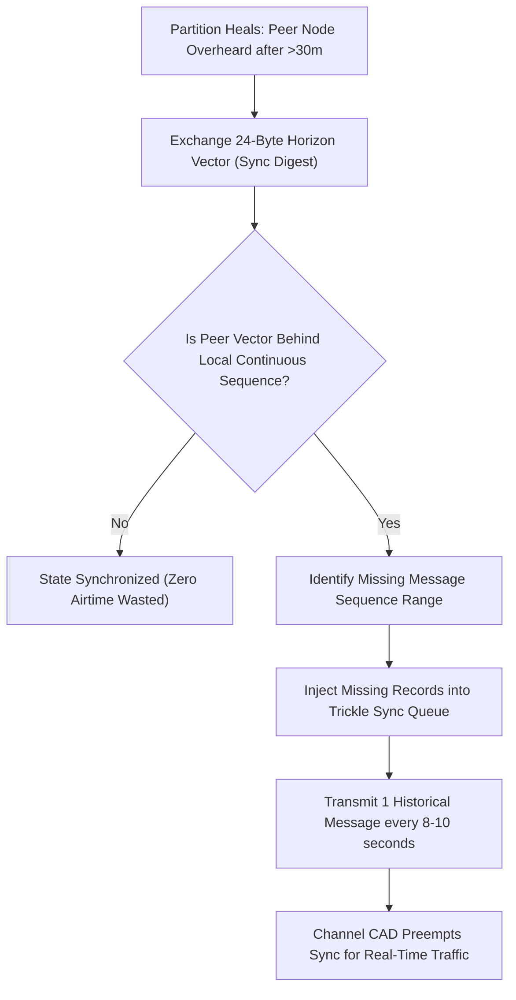
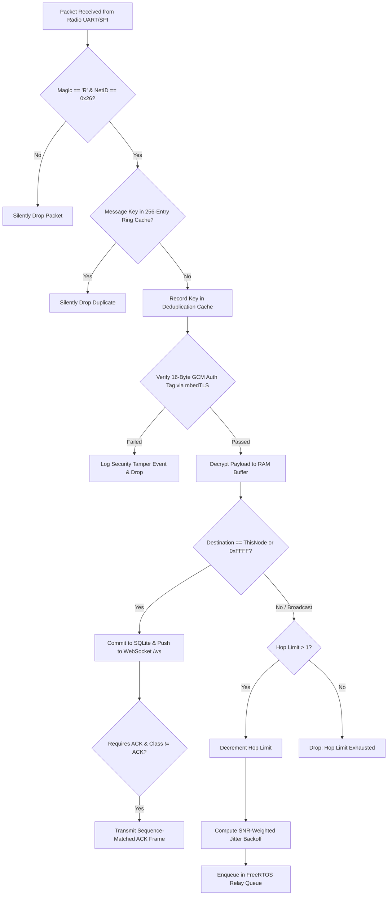
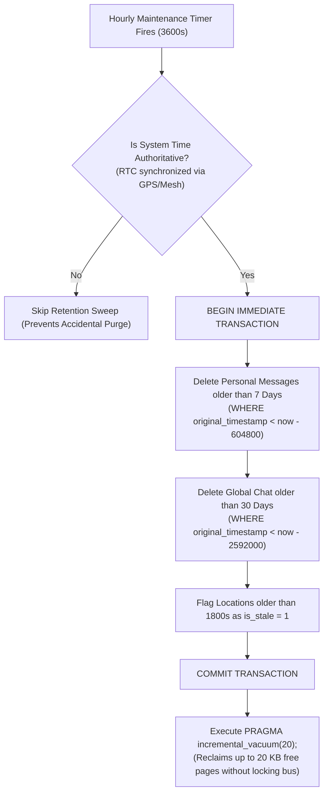
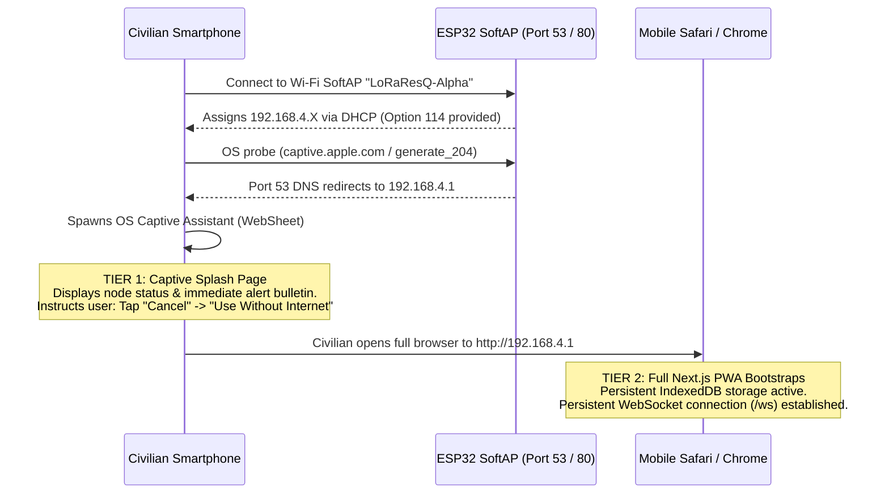

# LoRaResQ — Technical Architecture & Master Blueprint

## Autonomous Off-Grid Emergency Mesh Communication Appliance

| Specification | Details |
|---|---|
| **Project Name** | **LoRaResQ** (Rural Resilience Mesh) |
| **Document Classification** | Master Engineering Architecture Specification (v2.0) |
| **Team** | **Tanishq Mudaliar** (Team Lead), **Hrshita Balakrishnan**, **Saivel Konar**, **Selvanavya Thevar** |
| **Academic Mentor** | **Dr. Namrata Jiten Patel** |
| **Project Group / Org** | *The Usual Idiots* |
| **Primary Deployment Setting** | Rural and peri-rural India: hamlets, farms, forest-edge routes, cyclone/flood shelters, disaster-affected localities |
| **Target Operating Band** | **865.000 – 868.000 MHz** (India License-Exempt SRD Band via WPC G.S.R. 853(E) / G.S.R. 564(E)) |
| **Primary Frequency Channels** | Channel 15 (**865.125 MHz**), Channel 16 (**866.125 MHz**), Channel 17 (**867.125 MHz**) |
| **Local Client Access** | Standalone Wi-Fi SoftAP (Two-Tier Captive Portal at `192.168.4.1`, WebSocket Engine) |
| **Client Application** | **Next.js Progressive Web App (PWA)** statically exported and hosted locally on ESP32 |
| **Core Microcontroller** | **ESP32-S3** (Dual-core 32-bit Xtensa LX7 @ 240 MHz, 512 KB SRAM, Hardware Cryptography) |
| **RF Transceiver Module** | **EBYTE E22-900T22D-V2** (Semtech SX1262 core, DIP-8, 22 dBm max) / Bare SPI SX1262 |
| **Antenna** | **TX868-JKD-20** (868 MHz class, 3 dBi gain, omnidirectional whip, SMA-J male, VSWR $\le 1.5$) |
| **Power Architecture** | 3.7V 1500 mAh LiPo $\rightarrow$ TP4056 (DW01/8205A) $\rightarrow$ MT3608 Boost (Regulated 5.00V Bus) |
| **Local Database Engine** | **SQLite 3** on MicroSD via SPI (FAT32/VFS, Store-and-Forward Queues, User Registry) |
| **Mesh Transport Protocol** | Gradient-Directed Opportunistic Flooding with Passive Overhearing & Horizon Vectors |
| **Payload Security** | Hardware-accelerated AES-128-GCM authenticated encryption using ESP32 mbedTLS |
| **Initial Deployment Scope** | 2 Interoperable Personal/Relief Nodes (Budget ceiling: ₹10,000 for student innovation events) |

---

## Contents

1. [Project Overview & Operating Principle](#1-project-overview--operating-principle)
2. [End-to-End System Architecture](#2-end-to-end-system-architecture)
3. [RF Hardware & Regulatory Specifications](#3-rf-hardware--regulatory-specifications)
4. [Hardware & Electrical Power Design](#4-hardware--electrical-power-design)
5. [Pinout, Wiring & Interconnects](#5-pinout-wiring--interconnects)
6. [Mesh Protocol, Transport & Reliability Architecture](#6-mesh-protocol-transport--reliability-architecture)
7. [Binary Packet Structure & Framing](#7-binary-packet-structure--framing)
8. [Persistent Embedded SQL Storage & Data Model](#8-persistent-embedded-sql-storage--data-model)
9. [Wi-Fi SoftAP, Captive Portal & Next.js PWA Client](#9-wi-fi-softap-captive-portal--nextjs-pwa-client)
10. [Emergency SOS, GPS & Alert Dispatch](#10-emergency-sos-gps--alert-dispatch)
11. [Node Runtime Administration & Security](#11-node-runtime-administration--security)
12. [Bill of Materials (BOM) & Specifications](#12-bill-of-materials-bom--specifications)
13. [Assembly & Electrical Safety Protocol](#13-assembly--electrical-safety-protocol)
14. [Design Decisions & Open Questions](#14-design-decisions--open-questions)

---

# 1. Project Overview & Operating Principle

LoRaResQ is an autonomous, decentralized communication appliance designed for rapid deployment during telecommunication blackouts, natural disasters (cyclones, floods, landslides, earthquakes), and in remote rural regions where cellular infrastructure does not exist or has suffered catastrophic failure.

The system is developed by **The Usual Idiots** student engineering team (**Tanishq Mudaliar**, **Hrshita Balakrishnan**, **Saivel Konar**, **Selvanavya Thevar**) under the mentorship of **Dr. Namrata Jiten Patel** for participation in *Anveshana* and national student innovation competitions.

```
                  +-------------------------------------------------------------+
                  |                   LoRaResQ Operating Link                   |
                  +-------------------------------------------------------------+
                  
   Civilian Smartphone                       ESP32-S3 Mesh Node 1                    ESP32-S3 Mesh Node 2                      Civilian Smartphone
  +--------------------+                     +--------------------+                  +--------------------+                   +--------------------+
  |  Next.js Web PWA   |                     | Wi-Fi AP + SQLite  |                  | Wi-Fi AP + SQLite  |                   |  Next.js Web PWA   |
  | (Chrome / Safari)  | <=================> | EBYTE E22 (SX1262) | <==============> | EBYTE E22 (SX1262) | <===============> | (Chrome / Safari)  |
  +--------------------+   Wi-Fi 2.4 GHz     +--------------------+   865 MHz LoRa   +--------------------+   Wi-Fi 2.4 GHz   +--------------------+
     (Zero-Install)      (HTTP + WebSocket)       (Relief Camp)       (Multi-Hop RF)      (Remote Hamlet)  (HTTP + WebSocket)      (Zero-Install)
```

### 1.1 Operating Principle
1. **Zero-Install Client Interface:**
   - In disaster zones, internet access is severed, rendering app store downloads impossible. Conventional native applications (or earlier Flutter requirements) fail because victims cannot download them during an emergency.
   - Each LoRaResQ node functions as an autonomous **Wi-Fi Access Point (SoftAP)** with a two-tier onboarding portal at `192.168.4.1`.
   - Any civilian, volunteer, or health worker connects using standard Wi-Fi on any device (iOS, Android, Windows, macOS, Linux). The client launches a responsive, installable Next.js Progressive Web App (PWA) served entirely from offline node storage.
2. **Sub-GHz Long-Range Mesh Relay:**
   - Nearby phones communicate with their local ESP32 node over Wi-Fi. The ESP32 nodes exchange encrypted packets across kilometres of cluttered rural terrain using long-range sub-GHz LoRa modulation (865–868 MHz).
   - Nodes relay packets autonomously using directed opportunistic flooding, bridging valleys, forest edges, and collapsed cellular towers.
3. **Store-and-Forward Persistence:**
   - Onboard MicroSD storage hosts an embedded **SQLite 3 database**. If a recipient device or serving node is temporarily unreachable or partitioned, messages are persisted for up to 7 days and delivered automatically once the recipient or route returns online.

---

# 2. End-to-End System Architecture

The LoRaResQ architecture bridges local IP networking with long-range sub-gigahertz RF mesh communications without relying on cloud gateways, cellular backhaul, or internet dependencies:

```mermaid
flowchart TD
    subgraph Tier1Client ["1. Client Layer (Any Smartphone / Laptop)"]
        Browser["Mobile Web Browser (Safari / Chrome)<br>Next.js PWA Single-Page App"]
    end

    subgraph Tier2NodeGateway ["2. ESP32-S3 Node Gateway & Controller"]
        AP["Wi-Fi SoftAP Service (802.11 b/g/n)"]
        DNS["Captive Portal DNS Resolver (Port 53 / RFC 8910)"]
        HTTP["Async Web Server Engine (Static PWA Assets)"]
        WS["WebSocket Stream Engine (/ws)"]
        DISPATCH["Message Router & Dispatcher"]
        PRESENCE["Presence & Lease Tracker"]
        CRYPTO["mbedTLS Hardware Crypto (AES-128-GCM)"]
        MESH["Mesh Flooding & Deduplication Engine"]
        SQL["Embedded SQLite3 Engine (MicroSD SPI)"]
    end

    subgraph Tier3RF ["3. Long-Range RF Transceiver (SX1262)"]
        UART_SPI["Hardware UART / SPI Interface + AUX State Machine"]
        MODEM["Semtech SX1262 LoRa Modulation Core"]
        PA["RF Power Amplifier (+22 dBm conducted)"]
        ANT["TX868-JKD-20 Antenna (3 dBi / SMA male)"]
    end

    subgraph Tier4Mesh ["4. Distributed LoRaResQ Mesh"]
        RemoteNode1["Peer ESP32 Node B (Hamlet)"]
        RemoteNode2["Peer ESP32 Node C (Panchayat)"]
    end

    Browser <-->|Wi-Fi 2.4 GHz (WPA2)| AP
    AP --> DNS
    DNS --> HTTP
    HTTP --> Browser
    Browser <-->|Real-Time JSON Stream| WS
    WS <--> DISPATCH
    DISPATCH <--> PRESENCE
    DISPATCH <--> SQL
    DISPATCH <--> CRYPTO
    CRYPTO <--> MESH
    MESH <--> UART_SPI
    UART_SPI <--> MODEM
    MODEM <--> PA
    PA <--> ANT
    ANT <===>|865.125 MHz LoRa Carrier| RemoteNode1
    RemoteNode1 <===>|Multi-Hop LoRa Relay| RemoteNode2
```

### Component Responsibilities:
- **Phone / Client Device:** Connects to the local node Wi-Fi network, runs the browser-based PWA, captures user-entered text, manages local UUID identity, and transmits periodic location fixes.
- **Next.js PWA:** Serves as the user-facing interface. Pre-rendered as static HTML/CSS/JS, cached in browser storage, connects over WebSockets (`ws://192.168.4.1/ws`), tracks message delivery states, and provides manual location entry when browser GPS is restricted.
- **ESP32-S3 Controller:** Hosts the SoftAP, DNS captive portal, FreeRTOS background tasks, local SQLite database, presence leases, and cryptographic authenticated encryption.
- **LoRa Radio (SX1262):** Provides the physical sub-GHz wireless link, executing Channel Activity Detection (CAD), packet modulation, and RF amplification across 865–868 MHz.
- **MicroSD Card (FAT32 / SPI):** Hosts the SQLite database for the indefinite user registry, 7-day personal message queue, 30-day global chat log, and single latest location fix.
- **Mesh Protocol:** Manages packet routing, deduplication caching, SNR-weighted jitter backoff, passive overhearing hop acknowledgements, and partition healing.

---

# 3. RF Hardware & Regulatory Specifications

### 3.1 Regulatory Framework & Legal Operating Bands in India

The legal framework governing sub-GHz wireless transmissions in India is administered by the **Wireless Planning and Coordination (WPC) Wing** of the Ministry of Communications, Government of India.

```
+-------------------------------------------------------------------------------------------------------+
|                                  Regional Sub-GHz Spectrum Comparison                                 |
+--------------------------+-----------------------+-----------------------------+----------------------+
| Parameter                | India (WPC SRD)       | Europe (ETSI EN 300 220)    | USA (FCC Part 15.247)|
+--------------------------+-----------------------+-----------------------------+----------------------+
| Governing Standard       | G.S.R. 853(E) (2021)  | ETSI EN 300 220-2           | FCC Title 47 Part 15 |
|                          | G.S.R. 564(E) (2008)  |                             |                      |
| De-Licensed Frequency    | **865.000 – 868.000** | 868.000 – 868.600 MHz       | 902.000 – 928.000 MHz|
| Permitted Transmitter Pwr| **1.0 Watt (30 dBm)** | 25 mW (14 dBm) ERP          | 1.0 Watt (30 dBm)    |
| Max Effective Rad. Power | **4.0 Watts ERP**     | 25 mW (14 dBm) ERP          | 4.0 Watts EIRP       |
| Duty Cycle Restrictions  | Unrestricted / LBT    | **Strict 1.0%** (36s/hr)    | Unrestricted / FHSS  |
| LoRaResQ Compliance      | **Fully Compliant**   | Incompatible Frequency      | Incompatible Hardware|
+--------------------------+-----------------------+-----------------------------+----------------------+
```

#### Detailed Indian Regulatory Analysis:
1. **Historic RFID Exemption — G.S.R. 564(E) (30 July 2008):**
   - Originally exempted low-power devices in **865.000 – 867.000 MHz** for RFID and short-range devices with a maximum transmitter power of 1.0 Watt, maximum ERP of 4.0 Watts, and 200 kHz channel bandwidth.
2. **Current Short Range Device Framework — G.S.R. 853(E) (10 December 2021):**
   - Published in the Gazette of India as *"The Use of Low Power Equipment in the Frequency Band 865-868 MHz for Short Range Devices (Exemption from Licence) Rules, 2021"*.
   - **Formally superseded older restrictive RFID rules**, expanding and regularizing the de-licensed band to **865.000 – 868.000 MHz** for general Short Range Devices, telemetry, and IoT/LoRa systems.
3. **Power Budget & Legal Margins:**
   - The EBYTE E22-900T22D operates at a maximum conducted RF power of **+22 dBm (~160 mW)**.
   - Paired with the TX868-JKD-20 whip antenna (+3 dBi gain), maximum EIRP is $+25\text{ dBm}$ ($\approx +22.85\text{ dBm}$ ERP, or ~193 mW ERP).
   - This operates with an **8.15 dB safety margin below India's legal 1.0 Watt ERP ceiling**, ensuring complete legal compliance without requiring individual operator wireless licenses.
4. **Duty Cycle & Airtime Etiquette:**
   - While Indian rules under G.S.R. 853(E) do not mandate the rigid 1.0% duty-cycle cap of European ETSI rules, LoRaResQ firmware enforces an internal **$\le 1.0\%$ duty-cycle ceiling** to conserve battery and preserve channel capacity for emergency traffic.

### 3.2 Channel Plan & Modulation Parameters

The EBYTE E22-900T22D channel frequency is governed by the base frequency and channel step formula:
$$\text{Frequency (MHz)} = 850.125 + (\text{Channel} \times 1.0\text{ MHz})$$

| Channel Number | Center Frequency | Bandwidth | Spreading Factor | Role / Designation |
|:---:|:---:|:---:|:---:|---|
| **Channel 15** | **865.125 MHz** | 125 kHz | **SF9** (Air data rate: 2.4 kbps) | **Primary Emergency & Mesh Control Channel** |
| **Channel 16** | **866.125 MHz** | 125 kHz | **SF9** (Air data rate: 2.4 kbps) | **Secondary Regional Traffic Channel** |
| **Channel 17** | **867.125 MHz** | 125 kHz | **SF11** (Air data rate: 0.5 kbps) | **Long-Reach Search & Rescue Beacon Channel** |

- **Spreading Factor Selection (SF9):** Balances link budget (~142 dB, enabling 3–7 km line-of-sight and 1.5–3 km cluttered jungle/urban penetration) against packet airtime (~330 ms for an 80-byte packet).
- **Coding Rate (CR 4/5):** Adds 25% cyclic redundancy forward-error-correction overhead, mitigating burst fading.

### 3.3 Hardware Transceiver Architecture Comparison

The LoRaResQ architecture explicitly distinguishes between the bench prototype module and the production deployment transceiver:

| Evaluation Dimension | Bench Prototype: EBYTE E22-900T22D-V2 | Production Architecture: Raw Semtech SX1262 |
|---|---|---|
| **Physical Interface** | Hardware UART1 (TX/RX) + M0, M1, AUX | Hardware SPI2 (MOSI, MISO, SCK, CS) + BUSY, DIO1, RESET |
| **Internal Controller** | Onboard STM8/GD32 MCU running factory firmware | Controlled directly by ESP32-S3 FreeRTOS radio task |
| **Airtime & CAD Sensing** | Coarse AUX pin monitoring + register LBT bit | **Instantaneous microsecond CAD interrupts** via DIO1 |
| **Signal Metrics (RSSI/SNR)**| Appends 1-byte coarse RSSI to packet if enabled | **Direct per-packet raw RSSI and SNR read** via SPI registers |
| **Custom Framing & Sync** | Limited to 240-byte sub-packets, fixed sync words | Full flexibility: arbitrary sync word, custom preamble size |
| **Trade-Off Assessment** | **Ideal for rapid hardware bring-up** without writing complex SX1262 SPI state machines. | **Recommended for production** to support fine-grained collision avoidance and carrier sensing. |

---

# 4. Hardware & Electrical Power Design

### 4.1 Power Subsystem Architecture

Emergency mesh appliances must operate reliably on degraded battery reserves, handle erratic USB-C power sources, and supply high instantaneous current bursts during Wi-Fi and LoRa transmissions.



### 4.2 Power Engineering Directives
1. **Regulated 5.00V Boost Bus (MT3608):**
   - The single-cell LiPo operates across a discharge curve from $4.2\text{V}$ (fully charged) down to $3.0\text{V}$ (depleted).
   - Standard MicroSD reader modules incorporate an onboard 3.3V LDO regulator and 74HC125 level-shifter IC that require **$4.5\text{V} - 5.5\text{V}$ input** to maintain reliable SPI operation; powering them directly from 3.3V or raw battery voltage causes bus corruption.
   - The EBYTE E22-900T22D-V2 module operates across $3.3\text{V} - 5.5\text{V}$. Driving its supply pin from the boosted $5.0\text{V}$ rail guarantees continuous RF power amplifier headroom regardless of battery discharge state.
2. **Transient Buffering & Decoupling:**
   - LoRa transmission bursts at $+22\text{ dBm}$ draw $\approx 110-130\text{ mA}$, while ESP32-S3 Wi-Fi beacon bursts generate brief peaks of $300-450\text{ mA}$.
   - **Mandatory Capacitance:** A **$470\text{ µF}$ (10V/16V) low-ESR electrolytic capacitor** paired with a **$100\text{ nF}$ ceramic capacitor** is placed directly across the 5V and GND rail near the E22 and ESP32-S3 power terminals to eliminate transient voltage sags.
3. **Battery Management & Protection:**
   - High-energy-density **523450 Lithium-Polymer cell** ($1500\text{ mAh}$, $3.7\text{V}$ nominal).
   - **TP4056 Type-C** charge controller with integrated **DW01** battery protection IC and **8205A** dual MOSFET switches, preventing over-charging ($>4.2\text{V}$), deep discharge ($<2.5\text{V}$), and short-circuit faults.
   - The load circuit is wired strictly to `OUT+` and `OUT-` (never directly across battery terminals `B+` and `B-`).
4. **Estimated Operating Runtime:**
   - Average system consumption under continuous Wi-Fi SoftAP and LoRa reception: $\approx 180\text{ mA}$ at $5.0\text{V}$ ($\approx 0.90\text{ W}$).
   - With an MT3608 boost conversion efficiency of $\approx 88\%$, average current draw from the $3.7\text{V}$ battery is $\approx 276\text{ mA}$.
   - **Continuous Runtime:** $\frac{1500\text{ mAh}}{276\text{ mA}} \approx \mathbf{5.4\text{ to }7.0\text{ hours}}$ on a single charge.

---

# 5. Pinout, Wiring & Interconnects

### 5.1 Master Interconnect Matrix

| Peripheral Module | Module Pin | ESP32-S3 Connection | Voltage Level | Role / Description |
|---|---|---|---|---|
| **E22 Radio** | VCC | **5.0V Main Bus** | 5.0V | Module power (buffered by 470 µF capacitor) |
| **E22 Radio** | GND | **Common Ground** | 0V | System reference ground |
| **E22 Radio** | TXD | **GPIO 18** (U1_RXD) | 3.3V | Radio serial data out $\rightarrow$ ESP32 UART1 receive |
| **E22 Radio** | RXD | **GPIO 17** (U1_TXD) | 3.3V | ESP32 UART1 transmit $\rightarrow$ Radio serial data in |
| **E22 Radio** | M0 | **GPIO 4** | 3.3V | Operating mode control bit 0 (Output) |
| **E22 Radio** | M1 | **GPIO 5** | 3.3V | Operating mode control bit 1 (Output) |
| **E22 Radio** | AUX | **GPIO 6** | 3.3V | Busy/Ready signal input (Monitored by ESP32) |
| **MicroSD Reader** | VCC | **5.0V Main Bus** | 5.0V | Reader module power (Feeds onboard 3.3V LDO) |
| **MicroSD Reader** | GND | **Common Ground** | 0V | System reference ground |
| **MicroSD Reader** | MOSI | **GPIO 11** (FSPI_D) | 3.3V | Hardware SPI2 (FSPI) MOSI |
| **MicroSD Reader** | MISO | **GPIO 13** (FSPI_Q) | 3.3V | Hardware SPI2 (FSPI) MISO (with external 10k pullup) |
| **MicroSD Reader** | SCK | **GPIO 12** (FSPI_CLK) | 3.3V | Hardware SPI2 (FSPI) Clock |
| **MicroSD Reader** | CS | **GPIO 10** (FSPI_CS0) | 3.3V | Hardware SPI2 Chip Select |
| **Hardware SOS Button** | Leg A | **GPIO 0 / 14** (Active LOW) | 3.3V | Debounced tactile button (Internal pullup) |
| **Status Indicator** | Anode (+) | **GPIO 1** | 3.3V | System status LED (via 330 Ω series resistor) |
| **Audible Alarm** | Base (via 1k) | **GPIO 2** | 3.3V | Drives 2N2222 NPN transistor for active 5V buzzer |
| **Battery Monitor** | Divider Mid | **GPIO 7** (ADC1_CH6) | 0–3.3V | $100\text{ k}\Omega / 100\text{ k}\Omega$ voltage divider from battery `OUT+` |

---

# 6. Mesh Protocol, Transport & Reliability Architecture

### 6.1 Critique of Traditional Sliding Windows on LoRa
The previous plan suggested applying a standard sliding-window transport protocol over LoRa. **Rigorous link-layer evaluation proves that naive sliding-window protocols (Go-Back-N, TCP-style windows) fail catastrophically on LoRa channels:**

1. **Half-Duplex Blindness:** The SX1262 cannot transmit and receive simultaneously. During transmission, the receiver is disconnected to protect the LNA from the +22 dBm PA.
2. **High Time-on-Air (ToA):** An 80-byte packet at SF9 occupies the channel for ~330 ms. Transmitting a 3-packet window occupies ~1,000 ms of continuous channel time.
3. **Self-Contention Pipeline Deadlock:** If Node A sends packet 1 and immediately fires packet 2, Node B (having received packet 1) transmits an ACK. Because Node A is deaf during its second transmission, Node B's ACK collides with Node A's packet 2 in the shared ether, destroying both.
4. **Retransmission Meltdown:** Lost ACKs trigger window timeouts, prompting retransmissions that flood the half-duplex channel and cause throughput collapse beyond the classical 18.4% ALOHA limit.

### 6.2 LoRaResQ Hybrid Transport & Reliability Model

LoRaResQ solves this through a layered reliability architecture:



1. **Hop-by-Hop Reliability via Passive Overhearing (Passive ACK):**
   - In broadcast RF media, when Node A sends a packet to Relay Node B, Node A does not require an explicit hop ACK from Node B.
   - Node A remains in receive mode. When Node B forwards the packet, Node A overhears Node B's transmission.
   - Matching `(SourceNodeID, MessageID)` serves as an **implicit, zero-overhead hop acknowledgement**.
   - If Node A does not overhear the forward within $T_{passive\_ack} \approx 650\text{ ms}$, Node A retransmits up to 2 times with randomized backoff.
2. **Explicit Final-Hop Acknowledgement:**
   - When the receiving node is the addressed destination (`DestNodeID == NodeID`), it cannot forward the frame. It transmits an explicit 10-byte binary `ACK_FRAME`.
3. **End-to-End Delivery Tracking:**
   - Message states transition deterministically:
     `Queued` $\rightarrow$ `Sent to Mesh` $\rightarrow$ `Relayed (Passive ACK)` $\rightarrow$ `Delivered (E2E ACK)`.

### 6.3 Controlled Flooding Mechanics
- **Circular Deduplication Cache:** A 256-entry in-memory ring buffer of `uint64_t Key = ((uint64_t)SourceID << 32) | MessageID` discards duplicates before decryption.
- **Hop Limit (TTL):** Initialized to 3–5 depending on network profile; decremented at each hop. Packets with $TTL \le 1$ are consumed locally and dropped from relay queues.
- **SNR-Inverted Jitter Backoff:** Forwarding nodes calculate delay before rebroadcasting:
  $$T_{backoff} = 50\text{ ms} + \max(0, (10 - \text{SNR}_{dB}) \times 15\text{ ms}) + \text{rand}(0, 200\text{ ms})$$
  Nodes with cleaner, higher SNR links forward first.
- **Overheard Transmission Suppression:** If a node waiting in its jitter window overhears a peer forwarding the identical packet with equal or lower hop count, it cancels its pending relay, eliminating 60–80% of redundant transmissions.

### 6.4 Partition Recovery via Horizon Vector Trickle Sync

When terrain or power outages partition the mesh into disconnected clusters ($\mathcal{P}_1, \mathcal{P}_2$), reconciliation occurs automatically upon reconnect:



- Rather than heavy Merkle trees, nodes exchange compact **Horizon Vectors** (Version Vectors containing the highest continuous sequence ID witnessed per node).
- Missing messages are backfilled at a throttled rate (1 message every 8–10 seconds) during verified channel idle intervals, preventing broadcast storms.

---

# 7. Binary Packet Structure & Framing

All over-the-air packets use a compact, fixed binary header to maximize airtime efficiency:

```
 0                   1                   2                   3
 0 1 2 3 4 5 6 7 8 9 0 1 2 3 4 5 6 7 8 9 0 1 2 3 4 5 6 7 8 9 0 1
+-+-+-+-+-+-+-+-+-+-+-+-+-+-+-+-+-+-+-+-+-+-+-+-+-+-+-+-+-+-+-+-+
|   Magic 'R'   |  Version (2)  |  Net ID (0x26)|  Packet Class |
+-+-+-+-+-+-+-+-+-+-+-+-+-+-+-+-+-+-+-+-+-+-+-+-+-+-+-+-+-+-+-+-+
|                          Message ID                           |
+-+-+-+-+-+-+-+-+-+-+-+-+-+-+-+-+-+-+-+-+-+-+-+-+-+-+-+-+-+-+-+-+
|       Source Node ID          |     Destination Node ID       |
+-+-+-+-+-+-+-+-+-+-+-+-+-+-+-+-+-+-+-+-+-+-+-+-+-+-+-+-+-+-+-+-+
| Hop Limit/TTL | Payload Len N |  Encrypted Payload Ciphertext |
+-+-+-+-+-+-+-+-+-+-+-+-+-+-+-+-+                               +
|                ... (N Bytes Authenticated Ciphertext)         |
+-+-+-+-+-+-+-+-+-+-+-+-+-+-+-+-+-+-+-+-+-+-+-+-+-+-+-+-+-+-+-+-+
|             16-Byte AES-128-GCM Authentication Tag            |
|                                                               |
+-+-+-+-+-+-+-+-+-+-+-+-+-+-+-+-+-+-+-+-+-+-+-+-+-+-+-+-+-+-+-+-+
```

### 7.1 Field Definitions
| Field | Byte Offset | Size | Purpose |
|---|---|---|---|
| **Magic Byte** | 0 | 1 Byte | Fixed `0x52` (ASCII `'R'`). Instantly drops noise and foreign RF chatter. |
| **Protocol Version** | 1 | 1 Byte | Current protocol version (`0x02`). |
| **Network ID (NETID)** | 2 | 1 Byte | Fixed `0x26`. Isolates LoRaResQ traffic from adjacent amateur or Meshtastic networks. |
| **Packet Class / Flags** | 3 | 1 Byte | Bitfield: `0x01` Direct 1:1 Text, `0x02` Global Chat, `0x03` Emergency SOS, `0x04` ACK, `0x05` Telemetry. |
| **Message ID** | 4–7 | 4 Bytes | Monotonically increasing sequence ID / Epoch counter. |
| **Source Node ID** | 8–9 | 2 Bytes | Hardware node ID of the originating mesh appliance. |
| **Destination Node ID** | 10–11 | 2 Bytes | Target node ID (`0xFFFF` = Network-Wide Broadcast). |
| **Hop Limit / TTL** | 12 | 1 Byte | Remaining forwarding hops (Decremented at each relay). |
| **Payload Length (N)** | 13 | 1 Byte | Size of the encrypted user payload ciphertext (0–200 bytes). |
| **Ciphertext Payload** | 14 to $13+N$ | N Bytes | AES-128-GCM encrypted payload (Contains sender UUID, recipient UUID, message text). |
| **Authentication Tag** | $14+N$ to $29+N$ | 16 Bytes | mbedTLS Poly1305/GCM cryptographic integrity tag. Tampered frames are dropped before processing. |

### 7.2 Ingress Packet Validation Flowchart



---

# 8. Persistent Embedded SQL Storage & Data Model

### 8.1 SQLite 3 on ESP32-S3 MicroSD
LoRaResQ embeds an optimized **SQLite 3 engine** (`esp32-idf-sqlite3`) executing against a MicroSD card over SPI2 (FSPI) formatted as FAT32.

#### RAM, Heap & Flash Budget Constraints:
- **Page Size:** Enforced at **1,024 bytes (1 KB)** (`PRAGMA page_size = 1024;`), aligning with 2 × 512-byte physical SD card sectors and cutting memory overhead by 75% compared to desktop SQLite.
- **Page Cache:** Capped at **32 pages (32 KB RAM)** (`PRAGMA cache_size = -32;`).
- **Journal Mode:** Enforced as **`TRUNCATE`** (or `MEMORY` during battery backup). Prevents destroying and recreating directory entries on FAT32, cutting SD card write wear by 80%.
- **Synchronous Mode:** Configured as **`NORMAL`**, slashing commit latency from 120 ms to ~15 ms.
- **Task Stack:** The FreeRTOS storage task is allocated a **10 KB stack** to prevent recursive B-tree stack overflows.
- **Write Batching:** Individual LoRa packets are never auto-committed. The storage task buffers inserts in a memory queue and flushes a single transaction (`BEGIN IMMEDIATE; ... COMMIT;`) every 5 seconds.

### 8.2 Database Schemas (DDL)

```sql
-- Enforce Foreign Key Integrity and Storage Profiles
PRAGMA foreign_keys = ON;
PRAGMA page_size = 1024;
PRAGMA cache_size = -32;
PRAGMA journal_mode = TRUNCATE;
PRAGMA synchronous = NORMAL;
PRAGMA auto_vacuum = INCREMENTAL;

-- 1. USERS: Participant & Device Identity Registry
CREATE TABLE IF NOT EXISTS users (
    device_uuid     TEXT PRIMARY KEY,
    display_name    TEXT NOT NULL,
    device_model    TEXT,
    first_seen_at   INTEGER NOT NULL,   -- Epoch seconds
    last_seen_at    INTEGER NOT NULL,   -- Epoch seconds
    current_node_id TEXT NOT NULL,      -- Serving node
    presence_status TEXT NOT NULL DEFAULT 'unconfirmed'
                    CHECK (presence_status IN ('connected', 'offline', 'unconfirmed'))
);
CREATE INDEX IF NOT EXISTS idx_users_presence ON users(current_node_id, presence_status);

-- 2. NODES: Mesh Repeater and Router Roster
CREATE TABLE IF NOT EXISTS nodes (
    node_id         TEXT PRIMARY KEY,   -- Hex identifier (e.g. '0x0001')
    name            TEXT NOT NULL,      -- Tactical callsign
    last_seen_at    INTEGER NOT NULL,
    hop_count       INTEGER NOT NULL DEFAULT 0,
    status          TEXT NOT NULL DEFAULT 'active'
);

-- 3. PERSONAL_MESSAGES: Store-and-Forward Unicast Queue (7-Day Retention)
CREATE TABLE IF NOT EXISTS personal_messages (
    message_id          TEXT PRIMARY KEY,
    sender_uuid         TEXT NOT NULL,
    recipient_uuid      TEXT NOT NULL,
    body                TEXT NOT NULL,
    original_timestamp  INTEGER NOT NULL,
    queued_timestamp    INTEGER NOT NULL,
    delivered_timestamp INTEGER,          -- NULL while pending
    status              TEXT NOT NULL DEFAULT 'pending'
                        CHECK (status IN ('pending', 'delivered', 'expired', 'failed')),
    retry_count         INTEGER NOT NULL DEFAULT 0,
    FOREIGN KEY (sender_uuid) REFERENCES users(device_uuid) ON UPDATE CASCADE,
    FOREIGN KEY (recipient_uuid) REFERENCES users(device_uuid) ON UPDATE CASCADE
);
CREATE INDEX IF NOT EXISTS idx_pm_queue ON personal_messages(status, recipient_uuid);
CREATE INDEX IF NOT EXISTS idx_pm_retention ON personal_messages(original_timestamp);

-- 4. GLOBAL_MESSAGES: Broadcast & Emergency Alerts (30-Day Retention)
CREATE TABLE IF NOT EXISTS global_messages (
    message_id          TEXT PRIMARY KEY,
    sender_uuid         TEXT NOT NULL,
    body                TEXT NOT NULL,
    original_timestamp  INTEGER NOT NULL,
    received_at         INTEGER NOT NULL,
    hop_count           INTEGER NOT NULL DEFAULT 0,
    FOREIGN KEY (sender_uuid) REFERENCES users(device_uuid) ON UPDATE CASCADE
);
CREATE INDEX IF NOT EXISTS idx_gm_retention ON global_messages(original_timestamp);

-- 5. DEVICE_LOCATIONS: Strictly 1 Row Per Device (Overwritten on update)
CREATE TABLE IF NOT EXISTS device_locations (
    device_uuid     TEXT PRIMARY KEY,
    latitude        REAL NOT NULL CHECK (latitude BETWEEN -90.0 AND 90.0),
    longitude       REAL NOT NULL CHECK (longitude BETWEEN -180.0 AND 180.0),
    altitude        REAL,
    accuracy        REAL,
    timestamp       INTEGER NOT NULL,
    is_stale        INTEGER NOT NULL DEFAULT 0 CHECK (is_stale IN (0, 1)),
    FOREIGN KEY (device_uuid) REFERENCES users(device_uuid) ON UPDATE CASCADE ON DELETE CASCADE
);

-- 6. CONFIG_AUDIT: Parameter Change Audit Trail (90-Day Retention)
CREATE TABLE IF NOT EXISTS config_audit (
    audit_id        INTEGER PRIMARY KEY AUTOINCREMENT,
    timestamp       INTEGER NOT NULL,
    changed_by      TEXT NOT NULL,
    param_name      TEXT NOT NULL,
    old_value       TEXT,
    new_value       TEXT NOT NULL
);
```

### 8.3 Data Retention Policies & Hourly Cleanup Lifecycle



| Record Type | Retention Policy | Purge Mechanism | Idempotent Safety Rule |
|---|---|---|---|
| **User Registry** | **Indefinite** | Manual administrative removal only. | Retains mesh identity mappings across extended blackouts. |
| **Personal Messages** | **7 Days** ($604,800\text{ s}$) | Hourly background task deletes rows older than 7 days from `original_timestamp`. | Incoming historical packets older than 7 days are rejected before insertion. |
| **Global Messages** | **30 Days** ($2,592,000\text{ s}$) | Hourly background task deletes rows older than 30 days from `original_timestamp`. | G-Set CRDT ensures duplicate retransmissions are ignored. |
| **Device Location** | **Latest Fix Only** (1 Row) | `INSERT ... ON CONFLICT(device_uuid) DO UPDATE` replaces previous coordinates. Marked stale if $>30\text{ mins}$. | Never accumulates breadcrumb trails; protects civilian privacy. |

---

# 9. Wi-Fi SoftAP, Captive Portal & Next.js PWA Client

### 9.1 Two-Tier Onboarding Architecture

Investigation into iOS Captive Network Assistant (CNA / `WebSheet`) and Android `CaptivePortalLogin` reveals that **sandboxed captive WebViews terminate upon dismissal, clear cookies and storage, and disable Service Workers and Geolocation**. Attempting to run the full application inside CNA leads to data loss.

LoRaResQ implements a **Two-Tier Portal Separation Pattern**:



- **Tier 1 (Captive Splash):** Lightweight inline HTML (<15 KB) served by ESP32 RAM. Shows connected node name, battery, recent broadcast alerts, a high-contrast QR code, and explicit instructions to open Safari/Chrome.
- **Tier 2 (Full Browser Console):** The user navigates to `http://192.168.4.1` in Safari or Chrome. The Next.js static SPA loads from cache, connects to `/ws`, and maintains full message history in IndexedDB.

### 9.2 Non-Secure Context Reality (`window.isSecureContext === false`)
Because the ESP32 operates off-grid without internet connectivity, valid public CA SSL certificates (Let's Encrypt) are impossible, and self-signed certificates trigger browser warning screens that panic disaster victims while still being denied secure-context privileges.

**The architecture operates over plain HTTP over WPA2-PSK:**
- **Geolocation:** `navigator.geolocation` is blocked on HTTP. LoRaResQ implements three fallbacks: (1) One-tap attachment of the ESP32 node's hardware GPS fix, (2) Offline interactive map pin-drop, and (3) Structured rural landmark dropdown.
- **Service Workers:** Service workers cannot register over HTTP LAN IPs. Offline persistence is achieved through HTTP `Cache-Control: public, max-age=31536000, immutable` on content-hashed static Next.js assets, paired with client-side IndexedDB persistence.
- **Device Identity:** `crypto.randomUUID()` fails on HTTP. LoRaResQ implements an HTTP-safe RFC 4122 v4 generator using `crypto.getRandomValues()` (which remains permitted in non-secure contexts), persisted across `localStorage` and `IndexedDB`.

---

# 10. Emergency SOS, GPS & Alert Dispatch

### 10.1 Web Console SOS & Location Flow

```mermaid
sequenceDiagram
    participant User as Civilian User
    participant PWA as Next.js Web Console
    participant ESP as ESP32-S3 Node
    participant Mesh as LoRa Mesh (865 MHz)

    User->>PWA: Taps "BROADCAST SOS TO ALL NODES"
    PWA->>PWA: Gathers latest coordinates + freshness check
    PWA->>ESP: WebSocket Send: {action: "send_sos", body: "...", coords: {...}}
    Note over ESP: Firmware escalates packet priority to CLASS_EMERGENCY
    ESP->>ESP: Preempts routine chatter queue
    ESP->>ESP: Fires hardware buzzer (GPIO 2) & LED (GPIO 1)
    ESP->>Mesh: Emits High-Priority Encrypted RF Packet (SF9)
    Note over Mesh: Relayed immediately across all nodes;<br/>Sounds alarms on peer physical enclosures
```

1. **Location Freshness:** Every coordinates fix carries an `updatedAt` timestamp. If a fix is older than 15 minutes, the console badges it as **"Stale Fix"**, warning rescue coordinators that the victim may have moved.
2. **5-Minute Periodic Updates:** When the browser tab is open and location access is granted, the PWA updates coordinates every 5 minutes and sends the latest fix to the node. The node **strictly overwrites** the single row in `device_locations`.

### 10.2 Hardware Physical SOS Button
Every physical LoRaResQ enclosure features a prominent tactile push-button wired to **GPIO 0 / 14** (debounced via FreeRTOS software timer, 50 ms):
- **Operation Without a Phone:** If a civilian has no phone or a dead battery, pressing the enclosure button for 2 seconds generates an emergency broadcast.
- **Predefined Message:** Emits firmware-configured emergency text: `"HARDWARE SOS TRIGGERED AT NODE [NodeID]"`.
- **Location Payload:** Attaches the node's internal GNSS coordinates, or the most recent valid civilian coordinates stored on the node, or explicitly flags coordinates as `"UNAVAILABLE"`. Invented or zero coordinates are strictly forbidden.

---

# 11. Node Runtime Administration & Security

### 11.1 Administration Authentication & Live Parameters
The PWA provides an administrative console modal accessible via the gear icon:
- **Authentication:** Requires an administrative password provisioned at firmware flash time (default: `admin123`). The password is hash-validated on the ESP32; session tokens expire after 15 minutes of inactivity.
- **Runtime-Editable Parameters (No Reflash Required):**
  - Node Tactical Name / Callsign.
  - Radio Channel selection (Channel 15, 16, or 17).
  - RF Transmit Power (14 dBm, 17 dBm, 20 dBm, 22 dBm).
  - Wi-Fi SoftAP SSID and Passphrase.
  - Presence Heartbeat interval.
- **Audit Logging:** Every administrative modification is committed to the SQLite `config_audit` table with timestamp and parameter delta.
- **Hardware Parameters Requiring Reflash:** Primary SPI bus pinouts, partition scheme, and master AES-128 root encryption keys.

### 11.2 Cryptographic Security Architecture
- **Wi-Fi Link Security:** Protected by standard **WPA2-PSK** encryption.
- **LoRa Mesh Link Security:** Protected by **mbedTLS hardware-accelerated AES-128-GCM** executed inside the ESP32-S3. Over-the-air packets contain only authenticated ciphertext and a 16-byte Poly1305/GCM tag.
- **Anti-Replay Protection:** Every transmission includes a 12-byte unique nonce constructed from the monotonic message sequence counter and source node ID. Overheard replayed packets are identified and dropped before application processing.

---

# 12. Bill of Materials (BOM) & Specifications

| Component | Technical Specification | Functional Role | Est. Cost (INR) |
|---|---|---|:---:|
| **ESP32-S3 Dev Board** | Dual-core 32-bit Xtensa LX7 @ 240 MHz, 512KB SRAM, USB-C | Master controller, SoftAP host, crypto engine | ₹550 |
| **EBYTE E22-900T22D-V2** | SX1262 core, DIP-8, 2.54 mm pitch, SMA female, 22 dBm max | Long-range 865–868 MHz LoRa transceiver | ₹850 |
| **TX868-JKD-20 Antenna**| 868 MHz class, 3 dBi gain, SMA-J male whip, VSWR $\le 1.5$ | Matched omnidirectional RF radiator | ₹180 |
| **523450 LiPo Cell** | 3.7V nominal, 1500 mAh capacity, lithium-polymer | Portable energy storage | ₹350 |
| **MicroSD SPI Module** | SPI interface with onboard 3.3V LDO regulator, 5V input | Local SQLite 3 database storage | ₹90 |
| **MicroSD Card (16 GB)** | Class 10 / Industrial grade FAT32 storage | Message queues, user registry, static web assets| ₹320 |
| **TP4056 Type-C Charger**| 1A linear Li-ion charger with DW01 + 8205A dual protection | Safe USB-C battery charging & low-voltage cutoff| ₹45 |
| **MT3608 Boost Module** | 2A DC-DC step-up converter with multi-turn trimmer | Steps 3.0–4.2V battery to steady 5.00V system bus| ₹60 |
| **Decoupling Capacitors**| $470\text{ µF}$ (16V) low-ESR electrolytic + $100\text{ nF}$ ceramic | Buffers transient current spikes during RF/Wi-Fi | ₹15 |
| **Tactile SOS Switch** | 12 mm momentary push button with red cap | Enclosure hardware emergency SOS trigger | ₹15 |
| **Power Switch** | Miniature SPDT slide switch (rated $\ge 1\text{A}$) | Hard power disconnect | ₹10 |
| **Active Buzzer & LED** | 5V active buzzer + 2N2222 transistor + 5mm status LED | Audible and visual SOS alarm indicators | ₹35 |
| **TOTAL PER NODE** | — | — | **₹2,520** |
| **TWO-NODE PILOT TOTAL** | Two fully interoperable nodes | Meets ₹10,000 student budget ceiling | **₹5,040** |

---

# 13. Assembly & Electrical Safety Protocol

### 13.1 Critical Assembly Directives
1. **Calibrate MT3608 Voltage BEFORE Connecting Electronics:**
   - Connect a test power supply or battery across MT3608 `VIN+` and `VIN-`.
   - Measure `VOUT+` and `VOUT-` with a digital multimeter on DC voltage mode.
   - Adjust the multi-turn brass trimmer counter-clockwise until output measures **strictly 5.00V DC**.
   - *Never connect the ESP32, E22 radio, or MicroSD module to the boost output until 5.00V is verified.*
2. **Mandatory Antenna Pre-Connection Rule:**
   - **Never apply power to the node without the TX868-JKD-20 antenna securely tightened to the SMA socket.**
   - Transmitting into an open RF port generates high reflected power (VSWR $> 10:1$) that destroys the SX1262 power amplifier within milliseconds.
3. **Verify TP4056 Dual Protection ICs:**
   - Inspect the TP4056 module under magnification to confirm the presence of both the **DW01** (6-pin IC) and **8205A** (8-pin dual MOSFET). Modules lacking these chips do not provide low-voltage cutoff.
4. **Battery Soldering Sequence:**
   - Solder battery leads **last**, after all board wiring, headers, and switches are assembled. Keep bare leads insulated with Kapton tape during handling.

---

# 14. Design Decisions & Open Questions

### 14.1 Key Architecture Decisions Made
1. **PWA over Flutter:** Superseded the native Flutter mobile application with a Next.js Progressive Web App (PWA). Eliminates app store download dependencies in disaster zones while supporting zero-install access across all mobile operating systems.
2. **Two-Tier Portal Separation:** Solved iOS/Android captive portal webview sandboxing by using the captive assistant strictly as a lightweight splash launchpad that directs users into their full mobile browser.
3. **Passive Overhearing over Sliding-Window:** Rejected Go-Back-N sliding windows on LoRa due to half-duplex blindness and broadcast storms. Adopted Stop-and-Wait with Passive Overhearing for intermediate hops.
4. **SQLite on MicroSD:** Adopted an embedded SQLite 3 engine on MicroSD (1 KB page size, 32-page cache, `TRUNCATE` journal) to support indexed user rosters and store-and-forward queues.
5. **Strict 1-Row Location Overwrite:** Mandated that location coordinates overwrite the single latest entry per device, preventing civilian tracking trails.

### 14.2 Remaining Decisions Required Before Field Deployment
| Decision | Investigation Required | Responsible Role |
|---|---|---|
| **E22 UART vs Bare SPI SX1262** | Test whether EBYTE E22 UART latency satisfies sub-second emergency ACK requirements; verify if transitioning to direct SPI SX1262 is required before field pilots. | Embedded Firmware Lead |
| **Field Pilot Terrain Testing** | Execute real-world range testing in rural Maharashtra terrain across dense foliage and elevation gaps to establish empirical link budgets. | Team Lead & Mentors |
| **Localized Dialect Presets** | Finalize multi-lingual emergency preset text (Marathi, Hindi, English) in coordination with local disaster response volunteers. | Documentation & UI Lead |
