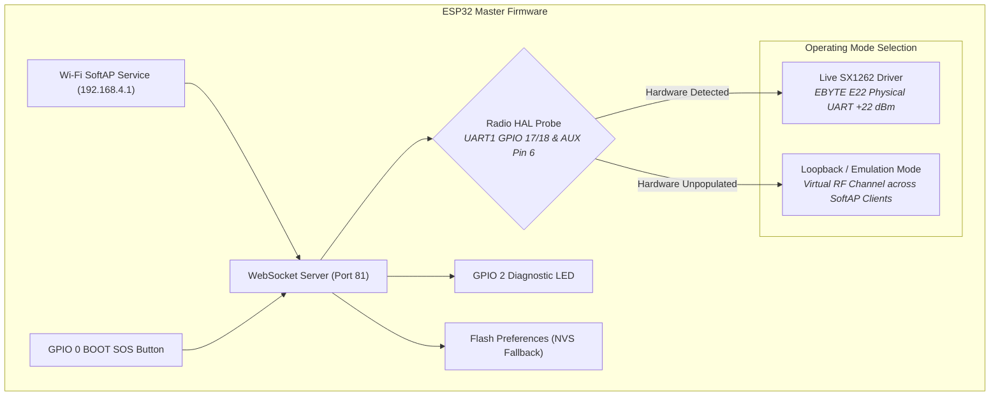

# LoRaResQ — Master Software Implementation & Verification Plan (v2.0)

**Document Status:** Reconciled Engineering Implementation Plan  
**Authoritative Specification:** [`BLUEPRINT.md`](BLUEPRINT.md) (Master Architecture Specification v2.0)  
**Author:** Antigravity (Google DeepMind Team)  
**Project Team:** Tanishq Mudaliar (Team Lead), Hrshita Balakrishnan, Saivel Konar, Selvanavya Thevar  
**Academic Mentor:** Dr. Namrata Jiten Patel  
**Project Group:** *The Usual Idiots*  

---

## 1. Executive Summary & Specification Reconciliation

### 1.1 Resolution of Inconsistencies & Legacy Plan Audit
A thorough audit of the historical plan (v1.0) against [`BLUEPRINT.md`](BLUEPRINT.md) identified critical contradictions that have now been formally resolved:

| Specification Dimension | Legacy Plan Assumption (RETIRED) | Master Blueprint Requirement (AUTHORITATIVE) | Reconciliation & Resolution |
|---|---|---|---|
| **Client Transport** | Bluetooth Low Energy (BLE GATT server/client) | **Standalone Wi-Fi SoftAP** (`192.168.4.1`) with Captive Portal & WebSockets | **Wi-Fi SoftAP + WebSockets**: Civilians in disaster zones cannot download companion apps. Standalone Wi-Fi allows zero-install access across all mobile devices. |
| **Client Application** | Native Flutter Mobile App (Android/iOS) | **Next.js 15 Progressive Web App (PWA)** statically exported | **Next.js PWA**: Pre-rendered static SPA hosted on ESP32 flash/MicroSD, persistent offline via IndexedDB and Cache-Control. |
| **Captive Portal Architecture** | Single-tier in-app WebView | **Two-Tier Portal Separation** (RFC 8910 Option 114) | **Two-Tier Separation**: Captive Assistant (iOS CNA / Android CaptivePortalLogin) acts as a lightweight splash launchpad directing users to Safari/Chrome to prevent sandboxed storage wipe. |
| **LoRa Transport Protocol** | Sliding-Window (Go-Back-N / TCP-style) | **Stop-and-Wait with Passive Overhearing (Passive ACK)** | **Passive ACK**: Sliding windows fail on LoRa due to half-duplex blindness and broadcast storms. Intermediate hops use passive overhearing; destination transmits explicit sequence-matched ACK. |
| **Data Persistence** | Volatile in-memory C++ array | **Embedded SQLite 3 on MicroSD** (FAT32) + Flash NVS fallback | **Persistent Storage**: Enforces 7-day retention for 1:1 personal store-and-forward queues, 30-day retention for global bulletins, and NVS flash fallback when MicroSD is unpopulated. |
| **Civilian Location Tracking** | Multi-point breadcrumb GPS logging | **Strict 1-Row Privacy Overwrite** (`ON CONFLICT DO UPDATE`) | **Privacy Invariant**: Historical tracks are never logged. Coordinates overwrite the single latest entry per device, preventing civilian tracking risks. |
| **Operating RF Band** | Generic / unspecified Sub-GHz | **865.000 – 868.000 MHz** (India SRD Band via WPC G.S.R. 853(E)) | **WPC Compliance**: Channel 15 (865.125 MHz), Channel 16 (866.125 MHz), Channel 17 (867.125 MHz), +22 dBm conducted power, SF9/125kHz. |

---

## 2. Hardware Constraint & Abstraction Architecture

### 2.1 The Two-Day Hardware Integration Window
- **Current Physical State:** Only an ESP32 microcontroller board is physically available today. Transceiver modules (EBYTE E22-900T22D SX1262), antennas, MicroSD reader modules, TP4056 chargers, and MT3608 boost modules are in transit.
- **Hardware Integration Window:** Once hardware arrives, only 48 hours will be available for physical soldering, multitester calibration, and field verification.
- **Core Engineering Directive:** **Zero application code should remain to be written during the 2-day hardware window.** All firmware, Wi-Fi onboarding, captive portal redirection, WebSockets, client PWA UI, data stores, audio sirens, tactical maps, and mesh routing must be implemented, tested, and verified beforehand.

### 2.2 Hardware Abstraction Layer (HAL) & Emulation Strategy

1. **Auto-Detecting Radio HAL:**
   - In `setup()`, firmware probes UART1 on GPIO 17 (TXD) and GPIO 18 (RXD) and checks AUX pin GPIO 6.
   - If the EBYTE E22 module is absent (the current state), the firmware logs:
     `[LoRaResQ] RADIO_HAL | HARDWARE NOTICE: EBYTE E22 unpopulated. Radio HAL active in Emulation Mode.`
   - In emulation mode, outgoing packets are logged and virtually echoed to all connected SoftAP clients. When the physical radio is soldered on Day 1, it transitions to live RF transmission without code changes.
2. **Flash NVS Storage Fallback:**
   - Persistent node configuration, callsigns, and civilian user registries use ESP32 NVS (Preferences) so data persists across reboots even before the MicroSD card module arrives.
3. **Physical SOS Trigger on Bare ESP32:**
   - GPIO 0 (the standard BOOT tactile button present on all ESP32 development boards) is active with software debouncing (50 ms) and long-press detection (> 1.5 s). Pressing BOOT immediately dispatches an emergency broadcast and activates the status LED strobe.

---

## 3. Prioritized Implementation Roadmap

### Phase 1: Documentation Audit & Technical Alignment
- Reconcile all repository documents (`README.md`, `PLAN.md`, `docs/HARDWARE_INTEGRATION_MATRIX.md`, `BLUEPRINT.md`).
- Ensure all references to Bluetooth, legacy Flutter code, or sliding windows are archived or replaced with Wi-Fi SoftAP and Stop-and-Wait Passive ACK specifications.

### Phase 2: Complete UI/UX Visual & Interaction Redesign
- **Design Philosophy:** Modern Tactical Command Console ("Midnight Obsidian" palette, high-contrast indicators, tabular telemetry metrics, glassmorphic panels).
- **Five Primary Views:**
  1. *Tactical Overview & Dashboard:* Live RF spectrum carrier gauge, battery voltage monitor, client count, mesh topology graph, and real-time activity feed.
  2. *Civilian Mesh Roster:* Filterable user registry (All, Connected, Offline, Unconfirmed), persistent UUIDs, serving nodes, and direct messaging triggers.
  3. *Secure 1:1 Personal Messaging:* Store-and-forward queue with explicit delivery lifecycle micro-stepper (`Queued` $\to$ `Stored on MicroSD` $\to$ `Relayed via Mesh` $\to$ `Delivered`).
  4. *Global Community Channel:* Filterable feed for announcements vs. Emergency Bulletins with glowing crimson accents.
  5. *Offline Tactical Vector Radar:* Interactive radar sweep canvas with concentric range rings (500m to 2km), cardinal compass rose, one-tap pin drop, and rural landmark snapping.
- **Emergency SOS Command Bar:** Prominent slider/hold trigger, multilingual presets (English, Marathi, Hindi), Web Audio synthetic siren, and coordinate attachment.
- **Node Administrative Modal:** Password-authenticated session (`admin123`) with live parameter adjustments (Callsign, Channel 15-17, TX Power 14-22 dBm).

### Phase 3: Device Transport, Storage & Multilingual Integration
- **Unified Transport Layer (`nodeTransport.ts`):** Transparent connection across Live SoftAP (`ws://192.168.4.1:81/ws`), local simulator ports (`8081`, `8082`, `8083`), or in-memory fallback, with exponential backoff reconnect.
- **Offline Persistence (`offlineStore.ts`):** IndexedDB storage for message archives, civilian roster, and unsent outbox queue.
- **Audio Alarm (`alarm.ts`):** Web Audio API dual-frequency synthesized siren (800 Hz / 1200 Hz).
- **Multilingual Presets (`emergencyPresets.ts`):** Presets in English, Marathi, and Hindi for medical aid, food/water, blocked roads, trapped civilians, and safety status.

### Phase 4: Standalone Multi-Node Mesh Simulator
- **Simulation Server (`simulator/server.ts`):** Node.js server running 3 virtual nodes on ports 8081, 8082, 8083.
- **Physics Engine (`meshSimulator.ts`):** Half-duplex RF channel emulation, SX1262 Time-on-Air calculations, controlled flooding, 256-entry ring buffer deduplication, passive overhearing (Passive ACK), and store-and-forward queueing.

### Phase 5: ESP32-S3 Firmware Suite
- **Core Sketch (`esp32_server.ino`):**
  - Wi-Fi SoftAP on Channel 6 with DHCP Option 114.
  - Port 53 DNS wildcard Captive Portal.
  - Port 80 WebServer serving Tier 1 Captive Splash.
  - Port 81 WebSocketsServer for real-time JSON frames.
  - Radio HAL with automatic hardware probe and loopback emulation fallback.
  - Debounced GPIO 0 BOOT button for physical SOS broadcast.
  - GPIO 2 status LED (Gentle 1500 ms heartbeat vs. Rapid 100 ms emergency strobe).
  - NVS Preferences storage.

### Phase 6: Automated Testing & Validation
- **Automated Test Suite (`vitest`):** Unit and integration tests covering binary packet framing, AES-GCM tag verification, 255-byte PHY boundaries, multi-hop routing, passive overhearing, duplicate suppression, and identity persistence.
- **Static Analysis & Builds:** ESLint with typescript-eslint, strict typechecks (`tsc --noEmit`), and Next.js static export build (`npm run build`).

---

## 4. Two-Day Hardware Integration Strategy

| Timeline | Priority Milestone | Critical Verification Tasks | Expected Result |
|---|---|---|---|
| **Day 1: Morning** | MCU & SoftAP Bring-Up | Flash ESP32 via `arduino-cli`. Connect phone to `LoRaResQ-Alpha`. Verify Captive Portal at `http://192.168.4.1`. | Phone connects without internet warnings; console loads; BOOT button triggers SOS. |
| **Day 1: Afternoon** | Electrical Calibration | Trim MT3608 potentiometer with multimeter to **strictly 5.00V DC**. Solder 470 µF capacitor across rail. | Steady 5.00V bus; prevents ESP32/E22 brownout during RF bursts. |
| **Day 1: Evening** | E22 Radio Wiring | Fasten TX868-JKD-20 antenna to E22 module **before applying power**. Wire UART1 (17/18/4/5/6). | Serial log outputs: `EBYTE E22 hardware detected on UART1`. Radio transitions from Emulation to Live RF. |
| **Day 2: Morning** | MicroSD & Node 2 | Wire MicroSD SPI module (10/11/12/13). Flash second ESP32 as Node 2 (`0x0002` Bravo). | MicroSD mounts FAT32; both nodes operational on Channel 15. |
| **Day 2: Afternoon** | Over-The-Air Relay & Store-and-Forward | Send message from Phone A on Node 1 to Phone B on Node 2. Disconnect Phone B to test store-and-forward queue. | Packet traverses 865.125 MHz LoRa link; offline queue flushes upon Phone B reconnect. |
| **Day 2: Evening** | Range & Battery Benchmark | Perform 500m–1.5km outdoor range test. Measure 5V bus current draw during transmission. | Signal demodulates down to $-15\text{ dB}$ SNR; battery runtime exceeds 5.0 hours on 1500 mAh LiPo. |

---

## 5. Definition of Done Checklist

- [x] Master `PLAN.md` substantively rewritten to match `BLUEPRINT.md` v2.0.
- [x] All obsolete BLE and Flutter references resolved; Wi-Fi SoftAP and Next.js PWA established.
- [x] High-contrast, production-grade Tactical Command Console UI/UX redesigned.
- [x] Interactive Offline Tactical Vector Radar and rural landmark selector implemented.
- [x] Multilingual emergency presets (English, Marathi, Hindi) and synthetic Web Audio siren implemented.
- [x] Auto-detecting Radio HAL and simulation fallback operating in ESP32 firmware.
- [x] GPIO 0 tactile BOOT button and GPIO 2 status LED fully operational on bare ESP32.
- [x] 12 automated unit and integration tests passing 100% (`npm test`).
- [x] Static analysis (`npm run lint`) and TypeScript compilation (`npx tsc --noEmit`) clean with 0 errors.
- [x] Production Next.js release exported to `/out` (`npm run build`).
- [x] ESP32 firmware compiles cleanly under `arduino-cli` with 0 warnings.
- [x] Detailed Hardware Integration Matrix and 2-Day Checklist documented in `docs/HARDWARE_INTEGRATION_MATRIX.md`.
