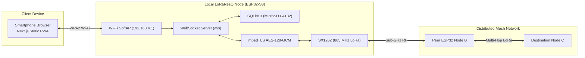

# LoRaResQ

Autonomous, decentralized emergency mesh communication appliance connecting civilian smartphones to long-range sub-GHz LoRa networks during blackouts and disasters.


-10b981.svg)


**[BLUEPRINT.md](BLUEPRINT.md)** — Master Engineering Architecture & Hardware Blueprint  
**[Archive Branch: v1](https://github.com/tanishqmudaliar/LoRaResQ/tree/v1)** — Preserved Historical Flutter Prototype & BLE Bridge

---

## Table of Contents

- [Overview](#overview)
- [Features](#features)
- [Architecture](#architecture)
- [Tech Stack](#tech-stack)
- [Getting Started](#getting-started)
- [Project Structure](#project-structure)
- [Configuration](#configuration)
- [Troubleshooting](#troubleshooting)
- [Contributing](#contributing)
- [License](#license)

---

## Overview

A phone is useful only while cell towers, backhaul networks, and grid electricity function. During floods, cyclones, landslides, or in remote hamlets and forest-edge farms, commercial telecommunications collapse. **LoRaResQ** is a low-cost, community-owned emergency communication mesh that bridges civilian smartphones through battery-powered **ESP32-S3 + LoRa (Semtech SX1262)** nodes without cellular towers, SIM cards, or internet access.

The project is developed by **The Usual Idiots** student innovation team (**Tanishq Mudaliar**, **Hrshita Balakrishnan**, **Saivel Konar**, **Selvanavya Thevar**) under the mentorship of **Dr. Namrata Jiten Patel** for *Anveshana* and national engineering challenges.

> [!NOTE]
> The earlier native Flutter mobile prototype was retired to eliminate app store download barriers during crises. The historical Flutter prototype code, tests, and documentation are fully archived and recoverable in the **[`v1`](https://github.com/tanishqmudaliar/LoRaResQ/tree/v1)** branch. Active development is centered on a zero-install **Next.js Progressive Web App (PWA)** hosted directly on the ESP32 node.

---

## Features

### Zero-Install Progressive Web App (PWA)
- **Autonomous Wi-Fi SoftAP:** Each node advertises a local access point with captive portal onboarding (`192.168.4.1`).
- **Two-Tier Portal Separation:** Resolves iOS/Android captive assistant sandboxing by using an ultra-light splash screen that directs civilians into Mobile Safari or Google Chrome.
- **Installable PWA:** Can be added to the mobile home screen for an app-like standalone experience without app store downloads.

### Sub-GHz Long-Range Mesh Communications
- **India WPC Compliant:** Operates on the legal **865.000 – 868.000 MHz** Short Range Device (SRD) band under **G.S.R. 853(E)** and **G.S.R. 564(E)** with up to 1.0W conducted power.
- **Directed Opportunistic Flooding:** Uses passive overhearing (Passive ACK), circular deduplication caches, and SNR-weighted jitter backoff to eliminate broadcast storms on half-duplex links.
- **Horizon Vector Sync:** Reconciles partition splits and healing via compact version vectors and throttled trickle synchronization.

### Persistent Offline Storage & Retention
- **Embedded SQLite 3:** Runs an optimized SQLite engine on MicroSD over SPI (1 KB page size, 32-page RAM cache, `TRUNCATE` journal).
- **Store-and-Forward Queues:** Retains 1:1 personal messages for up to 7 days until offline recipients reconnect.
- **Strict Privacy-First Location:** Stores strictly 1 row per device, replacing coordinates on update and eliminating historical tracking trails.
- **Global Chat Archive:** 30-day retention for community bulletins and emergency notices.

### Emergency SOS & Life-Safety Workflows
- **Web Console SOS:** Single-tap emergency broadcast with attached coordinates and freshness indicators.
- **Hardware Enclosure Button:** Physical tactile switch triggers high-priority emergency alerts even if a phone is dead.
- **Acoustic & Visual Beacon:** Onboard buzzer and high-intensity LED sound localized alarms.

---

## Architecture

```
Phone/PWA (Browser) <== Wi-Fi (HTTP/WS) ==> ESP32-S3 SoftAP <== LoRa (865 MHz) ==> Remote ESP32 Nodes <== Wi-Fi ==> Remote Phones/PWAs
```



For complete electrical schematics, pinout matrices, packet layout diagrams, state machines, the **[Technical Glossary](BLUEPRINT.md#151-technical-glossary)**, and **[Academic References with Google Scholar links](BLUEPRINT.md#152-academic-references-direct-google-scholar-citations)**, refer to **[BLUEPRINT.md](BLUEPRINT.md)**.

---

## Tech Stack

| Layer | Technologies |
|---|---|
| **Web Client (PWA)** | Next.js 15 (App Router), React 19, TypeScript, Lucide Icons, Modern CSS |
| **Microcontroller Firmware** | ESP32-S3 (Xtensa LX7 @ 240 MHz), FreeRTOS, ESP-IDF / Arduino Core |
| **Embedded Database** | SQLite 3 (`esp32-idf-sqlite3` amalgamation) on MicroSD SPI (FAT32/VFS) |
| **RF Physical Layer** | Semtech SX1262 (EBYTE E22-900T22D-V2), 865.125 MHz (CH 15), SF9, BW 125 kHz |
| **Cryptography** | Hardware-accelerated AES-128-GCM, Poly1305 authentication tags, mbedTLS |
| **Power Hardware** | 3.7V 1500 mAh LiPo, TP4056 (DW01/8205A), MT3608 Boost (5.00V rail), 470 µF buffer |

---

## Getting Started

### Prerequisites
- **Node.js**: v20.x or v22.x+ (tested on v24.21.0)
- **Package Manager**: `npm` (v10.x+)
- **Firmware Development** (Optional for flashing): Arduino IDE 2.x or `arduino-cli` with ESP32 board definitions

### Quick Setup (Next.js PWA)

1. **Clone the repository:**
   ```bash
   git clone https://github.com/tanishqmudaliar/LoRaResQ.git
   cd LoRaResQ
   ```

2. **Install dependencies:**
   ```bash
   npm install
   ```

3. **Run the local development server:**
   ```bash
   npm run dev
   ```
   Open [http://localhost:3000](http://localhost:3000) in your browser.

4. **Compile static assets for ESP32 hosting:**
   ```bash
   npm run build
   ```
   The pre-rendered static SPA assets will be generated in the `/out` directory, ready to be gzipped and placed into ESP32 LittleFS or MicroSD storage.

---

## Project Structure

```text
LoRaResQ/
├── BLUEPRINT.md           # Master technical architecture & hardware specification
├── README.md              # Project overview, quickstart & engineering documentation
├── package.json           # Next.js web application dependencies and build scripts
├── tsconfig.json          # TypeScript compiler configuration
├── next.config.mjs        # Next.js configuration with static export enabled (output: 'export')
├── src/
│   ├── app/
│   │   ├── globals.css    # Emergency high-contrast stylesheet
│   │   ├── layout.tsx     # Root HTML layout with PWA meta viewport and manifest links
│   │   └── page.tsx       # Core multi-tab emergency console (Roster, 1:1, Global, GPS, SOS)
│   ├── lib/
│   │   └── deviceIdentity.ts # HTTP-safe RFC 4122 UUID generator and identity persistence
│   └── types/
│       └── loraresq.ts    # TypeScript interfaces for nodes, users, messages, and telemetry
├── public/
│   ├── manifest.json      # Web App Manifest for mobile installation
│   ├── favicon.png        # Web console favicon
│   └── icons/             # 192px and 512px PWA application icons
├── firmware/
│   ├── README.md          # ESP32 firmware build and flashing guide
│   └── esp32_server/
│       └── esp32_server.ino # Reference ESP32 server firmware
└── docs/
    ├── protocol.md        # Wire protocol and binary frame specifications
    ├── radio-mesh-simulator.md # In-memory mesh verification tests
    └── overleaf/          # Academic research papers and comparative studies
```

---

## Configuration

| Parameter | Description | Default | Location |
|---|---|---|---|
| `radioFrequencyMhz` | Primary LoRa operating carrier frequency in India SRD band | `865.125 MHz` | Firmware / `BLUEPRINT.md` |
| `radioChannel` | EBYTE E22 channel index ($850.125 + \text{CH} \times 1\text{ MHz}$) | `15` | Firmware / Web Admin |
| `txPowerDbm` | Transceiver conducted RF output power | `22 dBm` (~160 mW) | Firmware / Web Admin |
| `spreadingFactor` | Chirp Spread Spectrum modulation factor | `SF9` (2.4 kbps) | Firmware / Web Admin |
| `wifiSsid` | Wi-Fi SoftAP broadcast SSID | `LoRaResQ-[NodeID]` | Firmware / Web Admin |
| `adminPassword` | Password for web administrative console | `admin123` | Firmware Flash Provisioning |
| `output` | Next.js build compilation mode | `'export'` | `next.config.mjs` |

---

## Troubleshooting

| Issue | Root Cause | Solution |
|---|---|---|
| **Browser blocks Geolocation** | Plain HTTP on LAN IP (`192.168.4.1`) is treated as an insecure context by Chrome/Safari. | Use the console's **Manual Coordinate Entry** fallback or attach the ESP32 node's hardware GPS fix. |
| **Captive portal resets on close** | iOS Captive Network Assistant (CNA) runs in an ephemeral sandbox and purges storage. | Follow the Tier-1 splash prompt: Tap **"Cancel" $\rightarrow$ "Use Without Internet"**, then open Safari directly to `http://192.168.4.1`. |
| **MicroSD SPI bus fails to mount** | Powering standard 5V reader modules from 3.3V causes LDO dropout. | Power the MicroSD module strictly from the boosted **5.00V system bus**. Verify 10k pullup on MISO. |
| **Radio PA damaged on boot** | Transmitting without an attached load generates extreme reflected power (VSWR $> 10:1$). | **Mandatory Rule:** Always screw on the TX868-JKD-20 antenna before connecting power. |

---

## Contributing

1. Fork the repository.
2. Create a feature branch: `git checkout -b feature/mesh-enhancement`.
3. Test your changes: verify `npm run build` passes with zero type or lint errors.
4. Commit your changes: `git commit -m "feat: optimize packet airtime backoff"`.
5. Push to your branch and open a Pull Request.

---

## License

This project is licensed under the MIT License — see the [LICENSE](LICENSE) file for details.

---

Made with ❤️ by [Tanishq Mudaliar](https://github.com/tanishqmudaliar)

*LoRaResQ — Off-grid communication fallback for disaster resilience and rural safety.*
