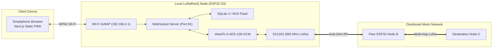

# LoRaResQ

Autonomous, decentralized emergency mesh communication appliance connecting civilian smartphones to long-range sub-GHz LoRa networks during blackouts and disasters.


-10b981.svg)


**[BLUEPRINT.md](BLUEPRINT.md)** — Master Engineering Architecture & Hardware Blueprint  
**[docs/HARDWARE_INTEGRATION_MATRIX.md](docs/HARDWARE_INTEGRATION_MATRIX.md)** — Master Hardware Integration Matrix & Two-Day Integration Checklist  
**[Archive Branch: v1](https://github.com/tanishqmudaliar/LoRaResQ/tree/v1)** — Preserved Historical Flutter Prototype & BLE Bridge

---

## Table of Contents

- [Overview](#overview)
- [Features](#features)
- [Architecture](#architecture)
- [Tech Stack](#tech-stack)
- [Getting Started & Development](#getting-started--development)
  - [1. Web Client & PWA](#1-web-client--pwa)
  - [2. Multi-Node Mesh Simulator](#2-multi-node-mesh-simulator)
  - [3. Automated Testing](#3-automated-testing)
  - [4. ESP32 Firmware Build & Flashing](#4-esp32-firmware-build--flashing)
- [Two-Day Hardware Integration Strategy](#two-day-hardware-integration-strategy)
- [Project Structure](#project-structure)
- [Configuration](#configuration)
- [Troubleshooting](#troubleshooting)
- [Contributing](#contributing)
- [License](#license)

---

## Overview

A phone is useful only while cell towers, backhaul networks, and grid electricity function. During floods, cyclones, landslides, or in remote hamlets and forest-edge farms, commercial telecommunications collapse. **LoRaResQ** is a low-cost, community-owned emergency communication mesh that bridges civilian smartphones through battery-powered **ESP32-S3 + LoRa (Semtech SX1262)** nodes without cellular towers, SIM cards, or internet access.

The project is developed by **The Usual Idiots** student innovation team (**Tanishq Mudaliar**, **Hrshita Balakrishnan**, **Saivel Konar**, **Selvanavya Thevar**) under the mentorship of **Dr. Namrata Jiten Patel** for *Anveshana* and national engineering challenges.

> [!NOTE]
> The earlier native Flutter mobile prototype was retired to eliminate app store download barriers during crises. The historical Flutter prototype code, tests, and documentation are fully archived and recoverable in the **[`v1`](https://github.com/tanishqmudaliar/LoRaResQ/tree/v1)** branch. Active development is centered on a zero-install **Next.js Progressive Web App (PWA)** hosted directly on the ESP32 node.

---

## Features

### Zero-Install Progressive Web App (PWA)
- **Autonomous Wi-Fi SoftAP:** Each node advertises a local access point with captive portal onboarding (`192.168.4.1`).
- **Two-Tier Portal Separation:** Resolves iOS/Android captive assistant sandboxing by using an ultra-light splash screen that directs civilians into Mobile Safari or Google Chrome.
- **Offline IndexedDB Storage:** Retains messages, mesh roster, and offline drafts across page reloads and AP handovers.
- **Offline Tactical Vector Map:** Interactive canvas/SVG grid allowing one-tap pin drops and rural landmark snapping without internet or tile downloads.
- **Multilingual Disaster Presets:** Quick one-tap disaster templates in **English, Marathi (मराठी), and Hindi (हिन्दी)**.
- **Acoustic Emergency Siren:** Web Audio API synthesized two-tone distress alarm (800 Hz / 1200 Hz) with strobe visual banner.

### Sub-GHz Long-Range Mesh Communications
- **India WPC Compliant:** Operates on the legal **865.000 – 868.000 MHz** Short Range Device (SRD) band under **G.S.R. 853(E)** and **G.S.R. 564(E)** with up to 1.0W conducted power.
- **Directed Opportunistic Flooding:** Uses passive overhearing (Passive ACK), circular deduplication caches (256-entry), and SNR-weighted jitter backoff to eliminate broadcast storms on half-duplex links.
- **Binary Packet Protocol:** 14-byte fixed transport header, AES-128-GCM encrypted payload, and 16-byte cryptographic auth tag.
- **Horizon Vector Sync:** Reconciles partition splits and healing via compact version vectors and throttled trickle synchronization.

### Hardware Abstraction Layer & Standalone Readiness
- **Bare ESP32 Hardware Emulation:** Firmware auto-detects whether the EBYTE E22 transceiver is populated. If running on a standalone bare ESP32, the firmware automatically operates in **Emulation / Loopback Mode**, allowing 100% verification of SoftAP, Captive Portal, WebSockets, and UI today before hardware arrives!
- **Hardware SOS Button:** Long-press on GPIO 0 (BOOT button on ESP32 development boards) immediately triggers enclosure emergency broadcast, blinking status LED and sounding buzzer.

---

## Architecture

```
Phone/PWA (Browser) <== Wi-Fi (HTTP/WS) ==> ESP32-S3 SoftAP <== LoRa (865 MHz) ==> Remote ESP32 Nodes <== Wi-Fi ==> Remote Phones/PWAs
```



For complete electrical schematics, pinout matrices, packet layout diagrams, and academic citations, see **[BLUEPRINT.md](BLUEPRINT.md)**.

---

## Tech Stack

| Layer | Technologies |
|---|---|
| **Web Client (PWA)** | Next.js 15 (App Router), React 19, TypeScript, Lucide Icons, IndexedDB, Web Audio API |
| **Microcontroller Firmware** | ESP32-S3 / ESP32 (Xtensa LX7 @ 240 MHz), FreeRTOS, Arduino Core |
| **Networking & Protocols** | Wi-Fi SoftAP, DNSServer (Port 53), WebServer (Port 80), WebSocketsServer (Port 81) |
| **RF Physical Layer** | Semtech SX1262 (EBYTE E22-900T22D-V2), 865.125 MHz (CH 15), SF9, BW 125 kHz |
| **Cryptography** | Hardware-accelerated AES-128-GCM, Poly1305 authentication tags, mbedTLS |
| **Power Hardware** | 3.7V 1500 mAh LiPo, TP4056 (DW01/8205A), MT3608 Boost (Strictly 5.00V rail), 470 µF buffer |

---

## Getting Started & Development

### 1. Web Client & PWA

Install dependencies and run the local development server:
```bash
npm install
npm run dev
```
Open [http://localhost:3000](http://localhost:3000) in your browser.

To generate static assets for offline ESP32 hosting:
```bash
npm run build
```
The optimized pre-rendered static SPA assets are exported to `/out`.

### 2. Multi-Node Mesh Simulator

Run the standalone 3-node mesh simulator to test end-to-end multi-hop routing, passive overhearing, and store-and-forward queueing locally on your computer:
```bash
npm run simulate
```
This spawns 3 virtual nodes:
- **Node 1 (Relief Camp Alpha):** `ws://localhost:8081/ws` -> Open `http://localhost:3000/?simPort=8081`
- **Node 2 (Waypoint Relay Bravo):** `ws://localhost:8082/ws` -> Open `http://localhost:3000/?simPort=8082`
- **Node 3 (Forest Hamlet Charlie):** `ws://localhost:8083/ws` -> Open `http://localhost:3000/?simPort=8083`

Open each URL in separate browser tabs to experience real-time multi-hop message relay and delivery ACKs!

### 3. Automated Testing

Run the full automated test suite (covering binary framing, encryption tags, 255-byte PHY limits, multi-hop routing, passive overhearing, duplicate suppression, and identity persistence):
```bash
npm test
```

Run code formatting and linting:
```bash
npm run lint
```

### 4. ESP32 Firmware Build & Flashing

The firmware is located in `firmware/esp32_server/esp32_server.ino`.

1. **Compile with Arduino CLI:**
   ```bash
   arduino-cli compile --fqbn esp32:esp32:esp32 firmware/esp32_server
   ```
2. **Flash to ESP32:**
   ```bash
   arduino-cli upload -p <COM_PORT> --fqbn esp32:esp32:esp32 firmware/esp32_server
   ```
3. **Verify Serial Trace at 115200 baud:**
   Observe the startup sequence confirming SoftAP, DNS, HTTP, and WebSocket engine readiness.

---

## Two-Day Hardware Integration Strategy

Because all missing hardware components are arriving for a limited 2-day integration window, the integration sequence is strictly prioritized:

- **Day 1: Electrical Calibration, Microcontroller Bring-Up & Single-Node Radio Integration**
  - Flash ESP32 and verify SoftAP onboarding and captive portal.
  - Verify GPIO 0 hardware SOS trigger and GPIO 2 status LED.
  - Calibrate MT3608 boost to **strictly 5.00V DC** before connecting peripherals.
  - Mandatory antenna attachment rule: never power EBYTE E22 without the 868 MHz whip antenna securely fastened.
  - Wire EBYTE E22 (TX: 17, RX: 18, M0: 4, M1: 5, AUX: 6) and verify transition from Emulation to Hardware Live mode.
  - Wire MicroSD SPI module (CS: 10, MOSI: 11, SCK: 12, MISO: 13).

- **Day 2: Multi-Node Integration, Store-and-Forward Queueing & Field Range Tests**
  - Flash Node 2 (Bravo) with Channel 15.
  - Validate over-the-air multi-hop packet relay between Node 1 and Node 2.
  - Test store-and-forward queueing with disconnected/reconnecting phones.
  - Execute outdoor range testing (500m to 1.5km) in rural terrain.
  - Benchmark battery runtime on the 1500 mAh LiPo cell.

For the full task checklist and pinout matrices, refer to **[docs/HARDWARE_INTEGRATION_MATRIX.md](docs/HARDWARE_INTEGRATION_MATRIX.md)**.

---

## Project Structure

```text
LoRaResQ/
├── BLUEPRINT.md           # Master technical architecture & hardware specification
├── README.md              # Project overview, quickstart & engineering documentation
├── .env.example           # Safe environment configuration template
├── package.json           # Next.js web application dependencies and build scripts
├── tsconfig.json          # TypeScript compiler configuration
├── next.config.mjs        # Next.js configuration with static export enabled
├── vitest.config.mts      # Automated test runner configuration
├── eslint.config.mjs      # Flat ESLint configuration
├── src/
│   ├── app/
│   │   ├── globals.css    # Emergency high-contrast stylesheet
│   │   ├── layout.tsx     # Root HTML layout with PWA meta viewport and manifest links
│   │   └── page.tsx       # Core multi-tab emergency console (Roster, 1:1, Global, GPS, SOS)
│   ├── components/
│   │   └── OfflineMap.tsx # Offline interactive vector tactical map and landmark picker
│   ├── lib/
│   │   ├── alarm.ts       # Web Audio synthetic emergency siren and visual strobe
│   │   ├── deviceIdentity.ts # HTTP-safe RFC 4122 UUID generator and identity persistence
│   │   ├── emergencyPresets.ts # Multilingual presets (English, Marathi, Hindi)
│   │   ├── protocol/
│   │   │   └── binaryPacket.ts # 14-byte binary transport framing, AES-GCM crypto & tags
│   │   ├── simulator/
│   │   │   └── meshSimulator.ts # Multi-node RF channel, passive ACK, and flooding engine
│   │   ├── storage/
│   │   │   └── offlineStore.ts # IndexedDB persistent store with localStorage fallback
│   │   └── transport/
│   │       └── nodeTransport.ts # WebSocket connection manager with reconnect & emulation fallback
│   └── types/
│       └── loraresq.ts    # TypeScript interfaces for nodes, users, messages, and packets
├── simulator/
│   └── server.ts          # Standalone multi-node WebSocket server (ports 8081, 8082, 8083)
├── tests/
│   ├── binaryPacket.test.ts # Packet framing and cryptographic verification tests
│   ├── meshRouting.test.ts  # Multi-hop routing, passive ACK, and deduplication tests
│   └── offlineStore.test.ts # Identity persistence and RFC 4122 tests
├── public/
│   ├── manifest.json      # Web App Manifest for mobile installation
│   ├── favicon.png        # Web console favicon
│   └── icons/             # 192px and 512px PWA application icons
├── firmware/
│   ├── README.md          # ESP32 firmware build and flashing guide
│   └── esp32_server/
│       └── esp32_server.ino # Master ESP32 SoftAP, Web, WS & Radio HAL firmware
└── docs/
    ├── HARDWARE_INTEGRATION_MATRIX.md # Master hardware-to-software integration matrix
    ├── protocol.md        # Wire protocol and binary frame specifications
    ├── radio-mesh-simulator.md # In-memory mesh verification tests
    └── overleaf/          # Academic research papers and comparative studies
```

---

## Configuration

| Parameter | Description | Default | Location |
|---|---|---|---|
| `radioFrequencyMhz` | Primary LoRa operating carrier frequency in India SRD band | `865.125 MHz` | Firmware / `BLUEPRINT.md` |
| `radioChannel` | EBYTE E22 channel index ($850.125 + \text{CH} \times 1\text{ MHz}$) | `15` | Firmware / Web Admin |
| `txPowerDbm` | Transceiver conducted RF output power | `22 dBm` (~160 mW) | Firmware / Web Admin |
| `spreadingFactor` | Chirp Spread Spectrum modulation factor | `SF9` (2.4 kbps) | Firmware / Web Admin |
| `wifiSsid` | Wi-Fi SoftAP broadcast SSID | `LoRaResQ-[NodeID]` | Firmware / Web Admin |
| `adminPassword` | Password for web administrative console | `admin123` | Firmware Flash Provisioning |
| `output` | Next.js build compilation mode | `'export'` | `next.config.mjs` |

---

## Troubleshooting

| Issue | Root Cause | Solution |
|---|---|---|
| **E22 Radio shows `HAL Emulation Mode`** | Hardware transceiver not yet connected (or loose wiring) | Firmware gracefully operates in simulation mode. Connect E22 to GPIO 17, 18, 4, 5, 6 when received. |
| **Browser blocks Geolocation** | Plain HTTP on LAN IP (`192.168.4.1`) is treated as non-secure context | Use the built-in **Offline Tactical Vector Map** to drop a pin or select a village landmark. |
| **Captive portal resets on close** | iOS Captive Network Assistant (CNA) purges storage on dismiss | Tap **"Cancel" $\rightarrow$ "Use Without Internet"**, then open Safari to `http://192.168.4.1`. |
| **MicroSD SPI bus fails to mount** | Powering standard 5V reader modules from 3.3V causes LDO dropout | Power the MicroSD module strictly from the boosted **5.00V system bus**. Verify 10k pullup on MISO. |
| **Radio PA damaged on boot** | Transmitting without an attached antenna causes severe VSWR reflections | **Mandatory Rule:** Always securely screw on the TX868-JKD-20 antenna before applying power. |

---

## Contributing

1. Fork the repository.
2. Create a feature branch: `git checkout -b feature/mesh-enhancement`.
3. Test your changes: verify `npm test`, `npm run lint`, and `npm run build` pass with zero errors.
4. Commit your changes: `git commit -m "feat: optimize packet airtime backoff"`.
5. Push to your branch and open a Pull Request.

---

## License

This project is licensed under the MIT License — see the [LICENSE](LICENSE) file for details.

---

Made with ❤️ by **The Usual Idiots** ([Tanishq Mudaliar](https://github.com/tanishqmudaliar), Hrshita Balakrishnan, Saivel Konar, Selvanavya Thevar) under the mentorship of **Dr. Namrata Jiten Patel**.

*LoRaResQ — Off-grid communication fallback for disaster resilience and rural safety.*
